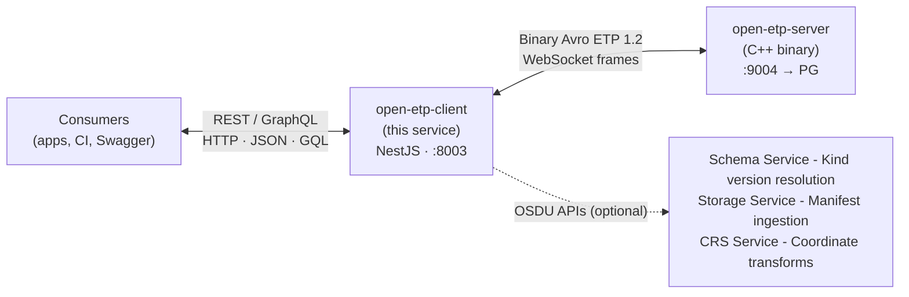
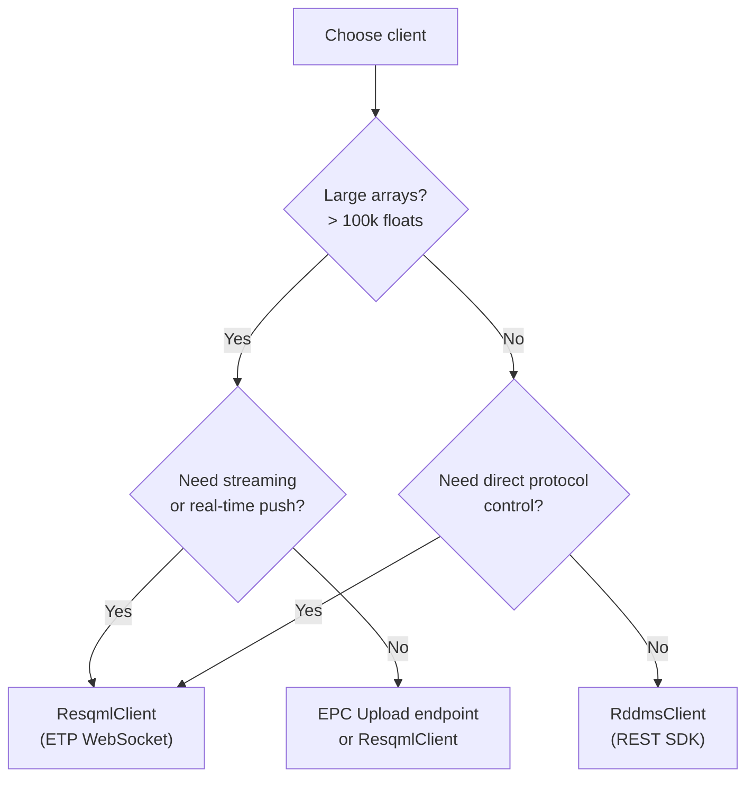

# @osdu/open-etp-client

REST and GraphQL gateway and SDK for [OpenETPServer](https://community.opengroup.org/osdu/platform/domain-data-mgmt-services/reservoir/open-etp-server). Bridges HTTP/JSON consumers to the binary Avro ETP 1.2 protocol - dataspace management, RESQML/WITSML/PRODML object access, data array streaming, OSDU manifest generation, EPC upload, and well search.



| Document                                                                                                                                 | Description                                                        |
| ---------------------------------------------------------------------------------------------------------------------------------------- | ------------------------------------------------------------------ |
| [REST SDK](./sdk/README.md)                                                                                                              | **Typed TypeScript SDK** - API reference, examples, quick start    |
| [Release Notes](./ReleaseNotes.md)                                                                                                       | Features, interfaces, and behavioral changes per milestone         |
| [Swagger UI](http://localhost:8003/Reservoir/v2/)                                                                                        | Interactive endpoint reference (served by the running application) |
| [RESQML → OSDU Guide](./ResqmlOsduGuide.md)                                                                                              | Populating RESQML metadata for lossless OSDU roundtrips            |
| [OpenETPServer](https://community.opengroup.org/osdu/platform/domain-data-mgmt-services/reservoir/open-etp-server/-/blob/main/README.md) | C++ ETP server: build, deploy, telemetry                           |

---

## Quick Start

```sh
# 1. Clone and install for standalone deployment/testing
git clone https://community.opengroup.org/osdu/platform/domain-data-mgmt-services/reservoir/open-etp-client.git
cd open-etp-client
npm install && npm run build

# 2. Configure
cp config.user.env.sample config.user.env
# Edit config.user.env - set RDMS_ETP_HOST, RDMS_ETP_PORT, etc.

# 3. Start ETP server (Docker) + REST API
npm run docker:compose:start    # OpenETPServer + PostgreSQL on :9004
npm run start                   # REST API on :8003
```

Open [http://localhost:8003/Reservoir/v2/](http://localhost:8003/Reservoir/v2/) for Swagger UI.

### Configuration

Set values in `config.user.env` (overrides `config.default.env`):

| Variable                   | Default         | Description                                                      |
| -------------------------- | --------------- | ---------------------------------------------------------------- |
| `RDMS_ETP_HOST`            | `localhost`     | ETP server hostname                                              |
| `RDMS_ETP_PORT`            | `9004`          | ETP server port                                                  |
| `RDMS_ETP_PROTOCOL`        | `ws`            | `ws` or `wss`                                                    |
| `RDMS_REST_PORT`           | `8003`          | REST API listen port                                             |
| `RDMS_REST_ROOT_PATH`      | `/Reservoir/v2` | REST API base path                                               |
| `RDMS_DATA_PARTITION_MODE` | `single`        | `single` or `multipartition` - see [Partitioning](#partitioning) |
| `RDMS_ETP_SSL_VERIFY`      | `true`          | Set `false` for self-signed certs                                |
| `RDMS_OSDU_URL`            | -               | OSDU platform URL (enables Schema Service, CRS lookups)          |
| `OSDU_MILESTONE`           | -               | Schema milestone hint (`M26`, `M27`, `M28`) - auto-resolved via Schema Service |

---

## API Reference

### REST API

Interactive Swagger UI at the configured root path. Includes full endpoint descriptions, workflow examples, and try-it-out.

| Category         | Key endpoints                                                             |
| ---------------- | ------------------------------------------------------------------------- |
| **Health**       | Liveness, readiness, server info, converter registry                      |
| **Dataspaces**   | CRUD, clone, lock/unlock                                                  |
| **Resources**    | List, get, validate, graph traversal (sources/targets)                    |
| **Data Arrays**  | Array metadata, content, upload with chunking                             |
| **Query**        | FindObjects, batch graph search                                           |
| **Write**        | PutDataObjects, DeleteDataObjects (requires transaction)                  |
| **Transactions** | Start, commit, rollback                                                   |
| **EPC Upload**   | Upload EPC + H5 file pair with auto-transaction and diagnostics           |
| **Manifest**     | OSDU manifest generation from ETP dataspaces                              |
| **Wells**        | Cross-dataspace well search with hierarchy resolution                     |
| **WITSML**       | Store/query WITSML 2.1 and 1.4.1 XML objects                              |
| **PWLS**         | Curve mnemonic resolution and validation                                  |

### GraphQL API

Available at `/graphql` (with Playground in development mode). Same data as REST with field-level selection and DataLoader batching.

Query types: `dataspaces`, `resources`, `graph`, `objectContent`, `arrayMetadata`.

### TypeScript REST SDK - `RddmsClient`

The `RddmsClient` class provides a **typed HTTP/JSON SDK** for the REST API. No ETP protocol knowledge, no binary framing, no XML - just typed method calls.

```typescript
import { RddmsClient } from "./sdk";

const rddms = new RddmsClient({
  baseUrl: "http://localhost:8080/api/reservoir-ddms/v2",
  partitionId: "dev"
});

// Atomic write: transaction → put objects → put arrays → commit (auto-rollback on error)
await rddms.atomicWrite("demo/test", [crs, hdfProxy, pointSet], [coordArray]);

// Read back
const types = await rddms.resources.types("demo/test");
const arr = await rddms.arrays.get(
  "demo/test",
  containerType,
  containerUuid,
  arrayPath
);
```

See [sdk/README.md](./sdk/README.md) for the full API reference and [src/examples/sdk/](./src/examples/sdk/) for runnable examples.

### TypeScript Library (low-level)

The `ResqmlClient` class talks raw ETP 1.2 binary protocol over WebSocket - you manage connections, Avro frame encoding, session negotiation, and multi-part message assembly. See [src/examples/](./src/examples/).

> **When to use which?**



#### Performance: SDK vs Direct ETP vs fesapi/pyetp

| Operation                     | SDK (REST/JSON)  | Direct ETP (ResqmlClient) | fesapi (C++) |  pyetp  |
| ----------------------------- | :--------------: | :-----------------------: | :----------: | :-----: |
| Metadata (list, get, graph)   |      ~20 ms      |          ~15 ms           |    ~12 ms    | ~17 ms  |
| atomicWrite (2 objects)       |      ~44 ms      |          ~30 ms           |    ~25 ms    | ~35 ms  |
| atomicWrite (1000 objects)³   |     ~180 ms      |          ~120 ms          |    ~80 ms    | ~150 ms |
| 100k float array read         |     ~200 ms      |          ~50 ms           |    ~30 ms    | ~80 ms  |
| 1M float array read           |       ~2 s       |          ~300 ms          |   ~150 ms    | ~500 ms |
| 1GB float array (125M floats) | **impractical**¹ |          ~50 s²           |    ~25 s     |  ~80 s  |

¹ JSON text for 125M floats is ~2.5 GB - exceeds Node.js heap and HTTP chunking limits. Use EPC upload or direct ETP for arrays this size.
² ETP chunks at 4 MB (~250 chunks for 1 GB). Throughput is ~20 MB/s over WebSocket with Avro framing.
³ Object writes scale sub-linearly: the gateway batches 100 objects per ETP message, so 1000 objects = 10 ETP messages inside 1 HTTP call + fixed transaction overhead (~22 ms). Not 500× the 2-object time.

For **metadata operations**, the SDK adds ~5–8 ms overhead per call - negligible for application use (ETP server + PG query time dominates). For **large array I/O** (>100k floats), JSON serialization becomes the bottleneck (~5–7× slower than binary Avro). For array-heavy workflows (seismic grids, simulation results), use the EPC upload endpoint or direct ETP.

---

## Deployment

### Docker Compose (local)

```sh
npm run docker:compose:start    # OpenETPServer + PostgreSQL
npm run start                   # REST API against Docker ETP server
```

### Azure (AKS)

See [devops/azure/README.md](devops/azure/README.md) for Helm chart and Azure DevOps pipeline setup.

### Production notes

- ETP server and client are **separate containers** - deploy with shared network
- OpenETPServer requires **PostgreSQL** (stores XML metadata and HDF5 arrays)
- Configure `RDMS_OSDU_URL` for Schema Service kind resolution; falls back to static versions (data-definitions aligned) if unavailable
- Health endpoints (`/health/liveness`, `/health/readiness`) are Kubernetes-ready
- SIGTERM triggers graceful shutdown: stops accepting requests, rolls back open transactions, exits within 30s

---

## Architecture

### ETP Protocols

All protocols are **auto-negotiated** at session open. Unsupported endpoints return 501.

| Protocol         | ID  | Purpose                                                      |
| ---------------- | --- | ------------------------------------------------------------ |
| Core             | 0   | Session management                                           |
| Discovery        | 3   | Resource enumeration, graph traversal                        |
| Store            | 4   | Get/Put/Delete data objects                                  |
| DataArray        | 9   | Array read/write with chunking                               |
| Transaction      | 18  | Start/commit/rollback                                        |
| Dataspace        | 24  | Create/delete/lock dataspaces                                |
| SupportedTypes   | 25  | Type enumeration                                             |
| StoreQuery       | 14  | FindDataObjects with content → `POST /query/objects/find`    |

---

## Testing

### Unit tests

```sh
npm run test                              # all (parallel, with coverage)
npm run test pattern1 pattern2            # subset by pattern
npm run test:single pattern1              # sequential, no coverage (debugging)
```

### Integration tests

Require a running ETP server:

```sh
npm run test:integration                  # TestClient + TestProtocols + TestWitsmlQuery
```

### Bruno API tests

The `bruno/` folder contains a [Bruno](https://www.usebruno.com/) collection for REST API testing. Environments: Local, Azure, CI.

```sh
npx bru run bruno/ --env Local            # headless CLI run
```

Manual workflow: run `_Setup/` requests → test individual endpoints → run `_Cleanup/`.

### CIMPL/Venus acceptance tests

`cimpl-dev-test` runs the strict acceptance profile with Node 22 and Bruno CLI
4.2.1. Other CI jobs and interactive Bruno environments retain their existing
behavior. The acceptance runner has three external inputs:

| Input | Meaning |
| --- | --- |
| `RESERVOIR_DDMS_HOST` | Full service base URL ending in `/api/reservoir-ddms/v2` |
| `DATA_PARTITION_ID` | Target test partition |
| `ACCESS_TOKEN` | Authorization token, optionally prefixed with `Bearer ` |

The CIMPL CI adapter obtains the token from its existing client-credentials
configuration. Provider credentials are not additional suite configuration.
The runner queries the caller's memberships at `/api/entitlements/v2/groups`
and requires exactly one returned group named `data.default.owners` and one
named `data.default.viewers`, which also proves the principal belongs to the
ACL groups it writes. It uses their actual email identifiers;
`ENTITLEMENTS_DOMAIN` is not required by this profile. Missing/ambiguous groups
and denied discovery are prerequisite failures, not skipped tests.

Required access must be provisioned by the environment owner, not by the tests:

| Operation | Required capability |
| --- | --- |
| Entitlements group discovery | List the principal's DATA memberships in the target partition, including the two groups above |
| Legal tag lifecycle | Create, read, and delete a per-run tag through `/api/legal/v1/legaltags` |
| Dataspace lifecycle | List, create, read, clone, lock/unlock, and delete run-owned dataspaces with the discovered owner/viewer ACLs |
| Seed and readback | Start/commit/rollback transactions, write objects/arrays, upload EPC/H5, validate, list resources, and read object content |

Exact service-role grants depend on the instance and still require maintainer
verification. The runner does not create groups, change IAM, infer grants from
token claims, or treat HTTP 403 as proof that a prerequisite exists.

**Both `data/Demo_Drogon.epc` and its matching `data/Demo_Drogon.h5` are required.**
Both are a small curated Drogon derived from the full fixture (epc ~360 KB +
h5 ~2.2 MB, 22 RESQML kinds including a synthetic 2x2x2 IJK grid) and are
committed directly as normal (non-LFS) git blobs, so no runtime download or
checksum step is needed. Missing files, Git LFS pointers, or invalid
ZIP/HDF5 signatures fail before test-created data is written. Drogon is not
silently skipped. A successful upload must report stored objects and arrays and
zero skipped arrays.

```sh
# Install the pinned CLI, then supply the three inputs through the environment.
npm install -g @usebruno/cli@4.2.1
node open-etp-client-acceptance-tests/acceptance-runner.cjs

# Run isolated lifecycle/failure tests (no OSDU instance or credentials needed).
npm run test:acceptance
```

The runner executes the existing `_Setup`, `Health`, `Dataspaces`, `DrogonSeed`,
and `_Cleanup` scenarios. Legal-tag creation and Drogon create/upload are
performed by the runner instead of the three equivalent Bruno request files;
the upload sends the EPC/H5 pair using Node multipart streaming. It does not
enable OSDU catalog auto-ingestion, which would create additional records
outside this REST-to-ETP lifecycle. Required HTTP errors, failed assertions,
missing reports, empty runs, and process errors all fail acceptance.

Each run uses random pipeline/job-scoped IDs for setup, CRUD, clone, and Drogon
dataspaces and its legal tag. An absence-checked ownership ledger is persisted
before writes, so cleanup can reconcile timeout-after-create cases. Teardown
runs even after a test failure, rolls back recorded transactions, removes only
run-owned resources, verifies absence, and deletes its tag last. Cleanup errors
fail the primary runner; the job's `after_script` retries cleanup independently
with a fresh token. The existing `allow_failure`/retry policy is unchanged:
a failed acceptance job may remain non-blocking, but it is not reported as passed.

Sanitized artifacts are written to `open-etp-client-acceptance-tests/results/`
(override with `ACCEPTANCE_RESULTS_DIR`, relative to the repository root):
`state.json`, `report.json`, and `cleanup-report.json`. The private Bruno
environment/raw reports in its `private/` subfolder contain
sensitive runtime state, are excluded from artifacts, and are deleted on normal
runner exit. Do not upload the entire working directory. A hard runner kill,
revoked credentials, or unavailable service can prevent immediate cleanup;
never interpret that as zero residual data.
Individual API calls are bounded to 15 seconds (120 seconds for EPC/H5 upload),
each Bruno invocation to 180 seconds, and cleanup to a 180-second budget plus
at most one in-flight API call. Exhaustion fails visibly and retains recovery state.

For recovery, restore the exact saved `state.json` to the path above, supply
fresh authorization for the same instance and partition, then run:

```sh
node open-etp-client-acceptance-tests/acceptance-runner.cjs --cleanup
# In CIMPL CI, reacquire authorization using the existing CI credentials:
node open-etp-client-acceptance-tests/cimpl-acceptance.cjs --cleanup
```

Do not edit the ledger to adopt unrelated resources. An unfinished ledger must
be cleaned before starting another run. Mock tests and a green build do not
establish live cleanup or configuration compliance: a refreshed DoD still needs
live CIMPL evidence and a declared completed-job denominator for the issue's
100% pass-rate target.

### Local ETP Server (Docker)

```sh
npm run docker:login               # once, for ACR access
npm run docker:update              # pull latest images
npm run docker:compose:start       # OpenETPServer on localhost:9004
```

---

## Reference

### Partitioning

Two modes (same as [ETP server](https://community.opengroup.org/osdu/platform/domain-data-mgmt-services/reservoir/open-etp-server/-/blob/main/README.md#partition-modes)):

- **Single-partition** - client handles one partition, does not transmit `data-partition-id` to server
- **Multi-partition** - expects `data-partition-id` header in REST requests, forwards to server

Set `RDMS_DATA_PARTITION_MODE` in config.

### Schema Version Support

Manifest builder resolves OSDU kind versions at startup:

1. **Schema Service query** - queries OSDU Schema Service for latest published versions (auto-adapts to M26/M27/M28+)
2. **Static fallback** - built-in `FALLBACK_KINDS` map (aligned with [data-definitions master](https://community.opengroup.org/osdu/data/data-definitions/-/tree/master/E-R)) if service unavailable

No configuration needed - adapts automatically to the target platform.

---

## Development

### Code style

```sh
npm run lint                  # eslint analysis
npm run prettier              # formatting check
npm run validate              # lint + prettier + tests in parallel
npm run lint:fix              # auto-fix lint issues
npm run prettier:write        # auto-fix formatting
```

Pre-commit hook runs `lint-staged` automatically.

### Packaging

```sh
npm run build && npm pack     # creates osdu-open-etp-client-x.x.x.tgz
npm i /path/to/osdu-open-etp-client-x.x.x.tgz   # install in another project
```

### Publishing

1. Update version in `package.json` + `npm i` to sync lock file
2. Update `CHANGELOG.md`
3. Create MR "Bump version to vX.Y.Z"
