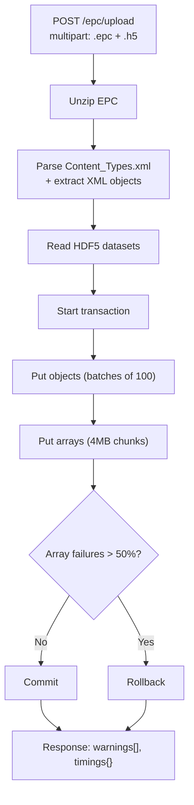

# Release Notes: Reservoir DDMS Client v1.3.0

Changes in the `open-etp-client` REST gateway since the M27 baseline (`cfffaa2`).

**Contents**

1. [OSDU Manifest Builder](#1-osdu-manifest-builder)
2. [EPC Uploader & RESQML Validator](#2-epc-uploader--resqml-validator)
3. [New Features & REST API](#3-new-features--rest-api)
4. [SDK, Examples & Tests](#4-sdk-examples--tests)
5. [Optimizations](#5-optimizations)
6. [Bug Fixes](#6-bug-fixes)
7. [Behavioral Changes ⚠️](#7-behavioral-changes-️)
8. [Known Issues & Authoring Gotchas](#8-known-issues--authoring-gotchas)

---

## 1. OSDU Manifest Builder

### Single dataspace per manifest 

A **WorkProduct** is now always emitted so the OSDU `Osdu_ingest` DAG carries its WorkProductComponents, and every build is scoped to a single dataspace. 

`POST /manifests/build` now rejects requests spanning more than one dataspace
with `400 EINVALID_ARGUMENT`. A WorkProduct is 1:1 with a dataspace (its
id / name / ETPDataspace / acl / legal are all derived from one dataspace) and
`Manifest.Data.WorkProduct` is singular; mixing dataspaces would tie every WPC -
and the ACL/legal backfill - to a single, arbitrarily-chosen dataspace and leak
governance across boundaries. **Build one manifest per dataspace instead.**

### Builder capabilities

- **Schema Service integration** - on boot, queries the OSDU Schema Service for
  the latest kind versions (M27+), falling back to static `FALLBACK_KINDS` if
  unavailable.
- **CollaborationProject** - auto-generates a `master-data--CollaborationProject`
  record per dataspace (deterministic UUID v5, lifecycle events).
- **Lineage** - auto-generated Activity linking source EPC to output records
  (suppressed by default; see below).
- **Best-effort mode** - converter errors skip the failed object instead of
  aborting the whole build. Inspect `errors[]` (and the per-build skip summary)
  in the response.
- **Smart property inclusion** - properties with canonical OSDU/PWLS names are
  auto-included; non-canonical ones excluded to avoid manifest bloat.
- **`excludePatterns`** - hard-exclude filter (comma-separated, `*`/`?`
  wildcards) applied before every inclusion rule except CRS, on both
  `POST /manifests/build` and `POST /dataspaces/{id}/epc/upload`. Defaults to
  `*Activity,*ActivityTemplate` (Activity records reference every property they
  consumed, which become dangling references under `propertyFilter=canonical`).
  Pass an empty value to disable.
- **`includeArrayData`** - opt-in to bulk array reads during manifest build.
- **OSDU self-identity precedence** - when resolving an object's OSDU SRN,
  `OSDUContext.osduAlias()` now prefers the RESQML 2.3.0 `OSDURecordID` element
  and falls back to `Aliases[Authority="osdu"].Identifier`. `OSDURecordID` is
  `String256`, so it carries a full partition-qualified SRN
  (e.g. `opendes:master-data--Wellbore:<uuid>:`) that overflows the alias
  `Identifier`. RESQML 2.0.1 / 2.2 objects are unaffected — they keep using the
  alias. Additive: manifest builds gain no new required input. Pairs with the
  `open-etp-server` `OES_GOVERNANCE_STRICT_SRN` guard on `PutDataObjects`.

Converter internals & round-trip fidelity (developer detail)

**20+ converters added**

| Category | Types |
| --- | --- |
| Reservoir modelling | IjkGrid enrichments (RealizationIndex, ParentGrid, HasTruncations, RockFluidOrganization), GenericBinGrid, HorizonControlPoints, ReservoirCompartmentInterpretation, GridConnectionSetRepresentation |
| Structural | StructuralOrganizationInterpretation, SeismicLineGeometry |
| PRODML | FluidModel (FluidCharacterization), ProductionValues (TimeSeriesData) |
| WITSML | Rig, Tubular, FluidsReport, BHARun, WellCompletion |
| WellLog flattening | WellboreFrame with N properties → single WellLog record |
| Master-data dedup | BoundaryFeature de-duplication on re-ingest |
| Lineage | Activity parameter extraction with typed values |

**Round-trip fidelity**

- **ExtraMetadata preservation** - non-`osdu/`-prefixed entries kept in
  `ResqmlMetadata`. Opt-in (default OFF); set `RDMS_PRESERVE_RESQML_METADATA=true`
  for lossless round-trip.
- **AuthoringSoftware** - `Citation.Format` mapped for all WPCs.
- **IjkGrid completion** - RealizationIndex, ParentGridID,
  RockFluidOrganizationInterpretationIDs, HasTruncations.
- **PropertyKind→UnitQuantity** - QuantityClass lookup for v2.2 PropertyKinds.
- **Activity parameters** - full typed extraction (String, Float+UOM, Integer,
  DataObject, TimeIndex).
- **Display labels** - InterpretationName prepended to WPC names.
- **Transmissibility detection** - GridConnectionSet reports
  `HasTransmissibilityMultipliers` when attached properties are found.
- **WellLog depth range** - WellboreFrame→WellLog populates Top/Bottom
  MeasuredDepth.

CRS enrichment (developer detail)

- **Vertical CRS extraction** - EPSG from inline (v2.0) or DOR-resolved (v2.2)
  definitions.
- **Local-frame metadata** - all 9 local engineering CRS parameters preserved in
  `rddms/localFrame/*` for lossless round-trip.
- **WKT CRS detection** - non-EPSG systems via WKT string parsing.
- **Rotated-CRS affine transforms** - correct SpatialArea bounding boxes for
  rotated local CRS.
- **LocalAuthority CRS (v2.2)** - company-managed CRS codes mapped to OSDU
  reference-data IDs.

---

## 2. EPC Uploader & RESQML Validator

**Highlights:** a bundled in-process RESQML validator (9 layers, no Python or
separate container) and a transactional EPC + H5 uploader with auto-rollback.

### EPC upload

`POST /dataspaces/{id}/epc/upload` accepts an EPC + H5 file pair, unzips, parses,
and ingests under a single transaction, with optional auto-ingest filters
(`typePatterns`, `propertyFilter`, `excludePatterns`) and opt-in RESQML
validation (`?validate=true`/`strict`).

- **Bounded memory** - H5 staged on disk (multer), arrays sent one at a time in
  4MB chunks.
- **Configurable limits** - `RDMS_EPC_MAX_SIZE_MB` (200), `RDMS_H5_MAX_SIZE_MB`
  (2048), `RDMS_EPC_MAX_OBJECTS` (10000).
- **Structured feedback** - `warnings[]` and per-phase `timings` in the response;
  rollback on >50% array-failure threshold to avoid half-ingested dataspaces.

Upload robustness & diagnostics (operational detail)

| Feature | Impact |
| --- | --- |
| `warnings[]` structured feedback | No log-scraping for issues |
| Per-phase `timings` (ms) | Performance visibility for large uploads |
| Rollback on >50% array failures | Prevents half-ingested corrupt dataspaces |
| Validate EpcExternalPartReference UUID refs exist in ZIP | Catches dangling HDF proxy refs early |
| H5 dataset size totals (`elements`, `bytes`) | Transfer size estimation |
| Configurable upload timeout (default 10 min) | Prevents hung requests on large H5 |
| Retry `putDataArray` once on transient failure | Handles intermittent ETP errors |
| Dtype compatibility warning (64-bit int) | Catches potential data-type issues |
| Duplicate UUID detection in EPC | Handles malformed EPCs from broken exporters |

### RESQML Validator (built-in)

A complete RESQML strict-validation engine bundled as an in-process TypeScript
module - no Python, no separate container, no subprocess.

- **9 validation layers** - EPC structure, XSD schema (libxmljs2/libxml2), DOR
  integrity, HDF5 references, cross-object consistency, business rules S01–S18,
  PWLS PropertyKind, fesapi compatibility, RDDMS compatibility.
- **Schema versions** - RESQML 2.0.1 and 2.2 (XSD schemas bundled). 
- **`ValidatorClient` local mode** - validation runs in-process by default; set
  `RDMS_VALIDATOR_URL` to fall back to an external HTTP validator service.
- **In-memory validation** - `validateObjects()` accepts XML strings directly
  (e.g. from ETP GetDataObjects), no EPC file needed.
- **Per-layer skip options** - `skip_xsd`, `skip_dor`, `skip_business_rules`,
  `skip_fesapi`, `skip_hdf5`, …

Validator performance across real datasets (4 authoring tools)

| Dataset | Source | Objects | Errors | Warnings | XSD time | Fast-path |
| --- | --- | --- | --- | --- | --- | --- |
| demo_seismic | pyetp | 6 | 0 | 2 | 656 ms | 3 ms |
| pyetp_demo | pyetp | 9 | 0 | 4 | 210 ms | 2 ms |
| Volve | ETP Client | 30 | 0 | 4 | 1.0 s | 7 ms |
| Olympus | DGI cv_etpexport + fesapi | 395 | 0 | 251 | 12.8 s | 95 ms |
| Teapot | DGI cv_etpexport + fesapi | 108 | 0 | 28 | 3.1 s | 23 ms |
| Drogon | Aspen RMS + ores (fesapi roundtrip) | 276 | 0\* | 46 | 8.3 s | 101 ms |

\* Drogon has 1 RDDMS-compat info (missing `.rels` for EpcExternalPartReference),
not a validity error.

Without XSD (fast-path), even the 395-object Olympus model validates in under
100 ms. XSD validation is ~30 ms/object.

---

## 3. New Features & REST API

**Highlights:** WITSML store/query, cross-dataspace well search, a GraphQL
endpoint, and opt-in RDF / linked-data and PWLS SKOS views - all additive, with
default JSON responses unchanged.

### REST endpoints

| Method | Path | Purpose |
| --- | --- | --- |
| POST | `/query/objects/find` | FindDataObjects with full XML content (ETP Protocol 14) |
| POST | `/query/graph/search` | Batch graph search - merged subgraph for multiple URIs |
| POST | `/dataspaces/{id}/epc/upload` | Upload EPC + H5 pair, parse, and ingest with transaction |
| GET | `/wells?name=&dataspace=&include=` | Cross-dataspace well search with hierarchy resolution |
| PUT | `/witsml/store` | Store WITSML 2.1/1.4.1 objects as XML or JSON, auto-transaction + channel extraction |
| POST | `/witsml/query` | Query WITSML objects with filters; `xml`/`json` output |

### GraphQL

New `/graphql` endpoint with field-level selection and DataLoader batching. Query
types: `dataspaces`, `resources` (lazy `content` and `arrays`), `graph`
traversal. Uses the same ETP session pool as REST.

### ETP protocol handlers

| Protocol | ID | Handler | Purpose |
| --- | --- | --- | --- |
| StoreQuery | 14 | `StoreQueryCustomer` | Bulk data-object retrieval |

### Semantic / Linked-Data (non-breaking, opt-in)

All items below are purely additive - default `application/json` responses are
unchanged. New behaviour is opt-in via the `Accept` header or `?format=`. No new
runtime dependencies.

- **Graph serializations** - the relationship-graph endpoints
  (`GET /dataspaces/{id}/resources/all`) now serve **CSV** (`text/csv`,
  RFC-4180 node table) and **GraphML** (`application/graphml+xml`, full
  nodes + edges) in addition to RDF (Turtle / JSON-LD / N-Triples).
- **Single-object RDF projection** -
  `GET /dataspaces/{id}/resources/{dataObjectType}/{guid}/rdf`, content-negotiated
  (`turtle`, `jsonld`, `ntriples`, `csv`, `graphml`; default Turtle).
- **Linked-Data metadata** (public, read-only) - `GET /rdf/context`,
  `GET /rdf/ontology`, `GET /rdf/alignment` (RESQML/WITSML → OSDU
  `owl:equivalentClass` crosswalk). Grouped under a **Linked Data** OpenAPI tag.
- **RFC 7807 errors** - `Accept: application/problem+json` returns problem
  documents (`type`, `title`, `status`, `detail`, `instance`); otherwise the
  default error shape is unchanged.

### Binary array transport (non-breaking, opt-in)

Raw-bytes array I/O for large numeric arrays, additive to the existing JSON
paths. Default responses are unchanged; binary is opt-in per request.

- **Binary read** - `GET .../resources/{dataObjectType}/{guid}/arrays/{path}?format=binary`
  streams the array as little-endian `application/octet-stream`, with
  `X-Array-Type` (the transport element type, e.g. `Float64Array`) and
  `X-Array-Dimensions` response headers. `format=json` (default) and
  `format=base64` are unchanged.
- **Binary write** - new `PUT .../resources/{dataObjectType}/{guid}/arrays/{path}`
  consumes `application/octet-stream`; `arrayType` and repeated `dimensions`
  (optional `starts`/`counts` for a subarray slice, `transactionId`) are query
  parameters. An empty body creates an empty array of the given shape. The
  existing batch `PUT .../resources/arrays` (JSON) is unchanged.
- **Why** - avoids base64's ~33% size inflation and JSON parsing for large
  numeric arrays, and lets the raw buffer stream straight through.

### Operational

- **Converter registry** - `GET /health/converters` lists all registered source
  types and target OSDU kinds.
- **SIGTERM graceful shutdown** - stops accepting requests, rolls back open
  transactions, exits within 30s.
- **SSL config** - `RDMS_ETP_SSL_VERIFY=false` for self-signed certificates.
- **Retry + array chunking** - exponential backoff and 4MB chunk limit for large
  array uploads.

### WITSML

- **Store** (`PUT /witsml/store`) - accepts WITSML 2.1 and 1.4.1 as XML or JSON
  (JSON converted to Energistics XML server-side). Auto-detects plural
  containers, generates deterministic UUIDs, extracts channel data and trajectory
  stations as ETP arrays.
- **Query** (`POST /witsml/query`) - rich filtering: `objectType`/`objectTypes`,
  `titleContains`, `uuids`, `modifiedSince` (incremental sync), `relatedTo` +
  `scope` traversal. `skip`/`top` pagination (response carries `count` + `total`)
  and `$format=xml|json`.
- **Well search** (`GET /wells`) - cross-dataspace search with automatic
  hierarchy resolution (wellbores, logs, trajectories, channelSets).

### PWLS

- **Catalogue as SKOS** - `GET /pwls/catalog` returns a JSON summary by default,
  or a SKOS `ConceptScheme` via `Accept`/`?format=` (one `skos:Concept` per PWLS
  property, vendor mnemonics as `skos:altLabel`; suppress with `?mnemonics=false`).

---

## 4. SDK, Examples & Tests

**Highlights:** a new typed `RddmsClient` HTTP/JSON SDK with runnable examples,
backed by 437 tests.

### TypeScript REST SDK - `RddmsClient`

New typed HTTP/JSON SDK in [`sdk/`](./sdk/) wrapping the REST API. Unlike the
low-level `ResqmlClient` (WebSocket/Avro, ETP protocol knowledge required),
`RddmsClient` talks plain HTTP/JSON - no binary protocols, no XML, no HDF5
linking.

- **Typed namespaces** - `rddms.dataspaces`, `.resources`, `.arrays`,
  `.transactions`, `.query`, `.graph`, `.health`, `.manifest`
- **`atomicWrite()`** - wraps start transaction → put objects → put arrays →
  commit, with auto-rollback on error
- **Auto-auth** - fetches a dev token from `GET /auth/token` when no static token
  is provided
- **Zero dependencies** - native `fetch` only

See [sdk/README.md](./sdk/README.md) for the full API reference.

### Runnable examples (hello worlds)

Five examples in [`src/examples/sdk/`](./src/examples/sdk/):

| Example | Demonstrates |
| --- | --- |
| `01-hello-pointset.ts` | PointSet + CRS + HdfProxy + coordinate array, full lifecycle |
| `02-grid2d-property.ts` | Grid2D with continuous property and multi-array write |
| `03-transactions.ts` | Commit vs rollback, `atomicWrite` helper |
| `04-query-graph.ts` | FindResources, batch graph search, list all |
| `05-dataspaces.ts` | Create, list, info, lock/unlock, clone, delete |

### Test coverage

| Suite | Count | Scope |
| --- | --- | --- |
| CRS and bugfixes | 41 | Bug fixes, rotation, routing, chunking, SIGTERM |
| Manifest | 12 | Converter registry, collaboration UUID, dedup, lineage |
| Seismic line geometry | 7 | Coordinate extraction and kind mapping |
| RDF / graph exports | 19 | CSV/GraphML, RDF writer, ontology/OWL alignment, PWLS SKOS |
| Reservoir converters | 40 | IjkGrid, FacetIDs, MilestoneKinds, PRODML |
| BinGrid + ControlPoints | 18 | GenericBinGrid, HorizonControlPoints routing |
| Activity converter | 9 | Parameter extraction (all typed variants) |
| Reservoir layer 1 | 146 | Smart property filter, transmissibility, ColumnBasedTable |
| Other (unchanged) | 148 | ETP protocol, client, error mapping, validation |
| RESQML Validator | 50 | 9 layers, real datasets (pyetp, Volve, DGI, fesapi), local mode |
| **Total** | **437** | `npm test` (+ 44 validator/dataset tests) |

Integration tests (require an ETP server): `npm run test:integration`.

### REST API documentation (OpenAPI / Swagger)

The interactive Swagger UI (served at the REST API root) is now the single source
of truth - the static `RestApi.md` has been removed and its content migrated into
the OpenAPI decorators.

- **Rich descriptions** - every operation documents purpose, required context
  (transaction, dataspace), chunking/batching notes, and inline examples.
- **Logical tag ordering** - health → auth → read → manifest → query → write →
  domain-specific (WITSML, PWLS) → metrics, preserved via a custom `tagsSorter`.
- **Operation ordering within Resources** - operations follow the natural
  read → drill-down → traverse flow; the deprecated `/graph/*` aliases are grouped
  after the canonical per-object `/targets` and `/sources` routes, and the
  rarely-used deleted-resources (tombstone) query is placed last in the section.
- **"When to use which" guidance** - the Resources tag description now
  distinguishes path-addressed reads, relationship traversal, and body-driven
  `POST /query/*` search, so callers can tell which endpoint fits their context.
- **Neutral examples** - request/response examples use neutral placeholder
  values rather than named products or vendors.
- **Regenerated specs** - `openapi.json`, `openapi.yaml`, and `swagger.json`
  reflect the enriched descriptions, WITSML `$format` flag, JSON store input,
  enriched query filters, and the opt-in binary array I/O (`?format=binary`
  read and the octet-stream `PUT .../arrays/{path}` write). Suitable for client
  generation.

---

## 5. Optimizations

**Highlights:** the large-array and XML paths are now memory- and GC-bounded -
several GB less peak memory on large uploads and 3–5× faster many-array writes.

Memory- and GC-focused improvements to the large-array and XML paths. All are
internal; no API changes.

Performance changes (developer detail)

| # | Change | Impact |
| --- | --- | --- |
| 1 | Chunked Buffer accumulation - array + single `concat` (was O(n²)) | Eliminates ~5 GB intermediate allocations for 50 MB chunked objects |
| 2 | Direct recursive BigInt converter replaces JSON stringify/parse roundtrip | Avoids double allocation for custom-data fields |
| 3 | `Set` for key filtering in `simpleJson` (was `Array.includes`) | O(1) lookup per property |
| 4 | XML builder uses `string[]` + `.join("")` instead of `+=` | Reduces GC pressure for 100KB+ XML |
| 5 | Index-based `slice` replaces mutating `splice`; loop-push replaces spread | Prevents stack overflow for 1000+ arrays |
| 6 | EPC validation passes file paths directly | Saves up to 4 GB redundant allocation |
| 7 | EPC HDF-proxy regex uses `lastIndex` instead of `slice` per match | Eliminates O(n×m) string allocations |
| 8 | Hoist regex constants out of per-object XML scanning loop | Avoids regex recompilation per object |
| 9 | Remove `new Uint8Array(h5Data)` copy - pass Buffer to emscripten FS | Saves 1× H5 file size in peak memory |
| 10 | Eliminate `Array.prototype.slice.call(array)` | Saves 1 full array copy per small upload |
| 11 | `new Array(n)` pre-allocation for chunked slices | Faster allocation for sub-array slicing |
| 12 | Parallel array uploads with bounded concurrency (default 5) | 3–5× faster for many small arrays |
| 13 | Zero-copy TypedArray chunking + Avro memcpy for float/double | 15% faster putArrays; ~1 GB less heap for large datasets |
| 14 | HTTP response compression (gzip/brotli) via `Accept-Encoding`, JSON only - raw `application/octet-stream` array streams are explicitly excluded | Smaller JSON on the wire; no CPU wasted gzipping incompressible binary array buffers |

---

## 6. Bug Fixes

**Highlights:** seismic easting/northing axis and bin-grid extent corrections
change emitted coordinates for affected CRS and grids.

| Ref | Summary | Impact |
| --- | --- | --- |
| [!268](https://community.opengroup.org/osdu/platform/domain-data-mgmt-services/reservoir/open-etp-client/-/merge_requests/268) | Easting/northing axis swap in seismic geometry | Corners/coordinates were both set to the northing value for northing-first CRS; only affected non-`easting northing` axis orders |
| [#79](https://community.opengroup.org/osdu/platform/domain-data-mgmt-services/reservoir/open-etp-client/-/issues/79) | Bin-grid extent off-by-one | Far corner overshot by one bin (used node count instead of interval count) |
| [!268](https://community.opengroup.org/osdu/platform/domain-data-mgmt-services/reservoir/open-etp-client/-/merge_requests/268) | ArealRotation wrong for rotated local CRS | Correct affine transform applied |
| [!268](https://community.opengroup.org/osdu/platform/domain-data-mgmt-services/reservoir/open-etp-client/-/merge_requests/268) | Circular reference resolution in `resolveReferences()` | Objects with mutual DORs now fully resolved |
| [!206](https://community.opengroup.org/osdu/platform/domain-data-mgmt-services/reservoir/open-etp-client/-/merge_requests/206) | Malformed reference IDs (`::` → `:`) in 8 converters | Structural/framework/rock-fluid references now resolve |
| [#67](https://community.opengroup.org/osdu/platform/domain-data-mgmt-services/reservoir/open-etp-client/-/issues/67) | TriangulatedSurface node count 3× overcount | `IndexableElementCount` was counting x,y,z separately |
| [!269](https://community.opengroup.org/osdu/platform/domain-data-mgmt-services/reservoir/open-etp-client/-/merge_requests/269) | WellLog `Top`/`BottomMeasuredDepth`/`SamplingInterval` null | `extractDepthRange()` falls back to a full `NodeMd` scan when `GetDataSubarray` returns empty |
| [#126](https://community.opengroup.org/osdu/platform/domain-data-mgmt-services/reservoir/open-etp-client/-/issues/126) | Invalid dateTime → HTTP 500 | Now returns 400 with a descriptive message |
| [#130](https://community.opengroup.org/osdu/platform/domain-data-mgmt-services/reservoir/open-etp-client/-/issues/130) | DELETE locked dataspace → 204 | Now propagates 403 |
| - | Duplicate `WorkProductComponent` ids in built manifests | A post-remap dedup pass drops duplicate WPC ids created when the schema-compatibility rewrite re-mints ids for unregistered kinds (e.g. repeated `HorizonControlPoints`) |
| - | Schema-existence cache poisoning → empty manifests | `isSchemaRegistered` only caches definitive answers (200 registered / 404 not-registered); transient auth/server failures (401/403/5xx) are treated as "assume present" and no longer cached, so a single stale-token schema lookup can no longer silently drop every WPC/MasterData/ReferenceData record until process restart |
| - | Schema-compatibility pass could empty a fully-converted manifest | The post-assembly schema-compat pass now reverts to the pre-pass records (and warns) when a normalize would drop **100%** of a non-empty `MasterData`/`ReferenceData`/`WorkProductComponents` array, so a mis-resolving schema service can no longer ship an empty manifest despite a successful conversion. `X-Manifest-Build-Diagnostics` gains `assembled`, `schemaCompat`, `finalCounts`, and `osduUrl` to pinpoint where records are dropped |
| - | Stale `GET /health/info` example in OpenAPI/Swagger docs | The `ClientInfoDto` schema example advertised a 2023 `version`/`commitId`/`commitTime`/`buildTime` (and a `commitId` that violated its own hex pattern); examples now reflect the real build-identity shape and the timestamp pattern accepts timezone-offset (`+`) values |
| - | `GET /dataspaces/{id}/deleted` hung forever on a missing dataspace | A server `ProtocolException` (e.g. `ENOT_FOUND`) to a `GetDeletedResources` request is now offered to the deleted-resources handler as well as the resources handler, so the request rejects with the proper HTTP error instead of waiting for the response timeout |
| - | Schema-compat pass wasted a round-trip storm when the schema service has nothing registered | When the pre-warm probe shows **every** distinct kind returns a definitive `404`, the normalize pass is now skipped wholesale (no per-record `resolveKind`, no drop-then-revert churn) and `X-Manifest-Build-Diagnostics.schemaCompat` reports `skipped:true`. Transient/unreachable errors are treated as "assume present" (never `false`), so a flaky OSDU cannot trip the skip |
| - | Large-dataspace manifest builds dropped mid-flight (HTTP 000/500) | The core-plus Istio `VirtualService` route now sets `timeout: 300s`; the mesh default (~15s) was severing long linear builds (ETP fetch + convert per object) before completion |

---

## 7. Behavioral Changes ⚠️

**Highlights:** manifest builds now reject multi-dataspace requests with `400`
and always emit a WorkProduct.

These may affect existing consumers.

| Change | Old behavior | New behavior | Workaround |
| --- | --- | --- | --- |
| **Manifest scope** ([!373](https://community.opengroup.org/osdu/platform/domain-data-mgmt-services/reservoir/open-etp-client/-/merge_requests/373)) | Multi-dataspace requests produced one manifest | `POST /manifests/build` returns `400` for >1 dataspace | Build one manifest per dataspace |
| **WorkProduct emission** | WPCs could be dropped by the DAG | WorkProduct always emitted so WPCs ingest | - |
| **Default manifest filter** ([!311](https://community.opengroup.org/osdu/platform/domain-data-mgmt-services/reservoir/open-etp-client/-/merge_requests/311)) | All RESQML types included | Types **and** properties included by default; filtering opt-in via `typePatterns` and `propertyFilter` (`all`/`canonical`/`none`); CRS always included | Pass `typePatterns` / `propertyFilter` to narrow |
| **Lineage / PropertySet** | Lineage Activity + PropertySet containers emitted | Dropped by default (dangling-reference sources) | Adjust `excludePatterns` to re-include |
| **Grid2d routing** | Depth-domain Grid2d + HorizonInterpretation → GenericRepresentation | → StructureMap if kind defined | - |
| **DELETE locked dataspace** ([#130](https://community.opengroup.org/osdu/platform/domain-data-mgmt-services/reservoir/open-etp-client/-/issues/130)) | 204 (silent success) | 403 | Unlock before delete |
| **Protocol negotiation** ([!289](https://community.opengroup.org/osdu/platform/domain-data-mgmt-services/reservoir/open-etp-client/-/merge_requests/289)) | `RDMS_ETP_EXTENDED_PROTOCOLS` env var | Auto-negotiated, env var removed | - |
| **Dataspace ACL override** ([!207](https://community.opengroup.org/osdu/platform/domain-data-mgmt-services/reservoir/open-etp-client/-/merge_requests/207)) | ETP customData always overrode pre-configured ACLs | Pre-configured ACLs take priority | - |
| **Clone re-identify** | `clone?reidentify=true` on a server that cannot copy dataspace content silently returned an identity-preserving clone | Now fails loud with `501 ENOTSUPPORTED` so callers do not get colliding UUIDs | Retry without `reidentify` for a reference snapshot |

---

## 8. Known Issues & Authoring Gotchas

**Highlights:** most of these are **EPC-authoring** pitfalls that surface as import or
commit errors rather than client defects. They are collected here so an ingest failure is
quick to diagnose.

| Area | Symptom | Cause & workaround |
| --- | --- | --- |
| **Mixed DOR format** | `"N Missing reference(s)"` on `CommitTransaction` | A v2.0.1 `<eml:ContentType>…type=obj_TypeName</eml:ContentType>` DOR left inside a v2.2 EPC resolves against `TypeName` (no `obj_`) and cannot match a stored object. Convert **all** DORs to the v2.2 form (`<eml:Uuid>` + `<eml:QualifiedType>resqml22.TypeName</eml:QualifiedType>`) before upload. |
| **`<Default Extension="xml">`** | Server misidentifies object types / parse issues | A `<Default Extension="xml">` entry in `[Content_Types].xml` overrides every per-part `<Override>`. Use `<Override>` entries only. |
| **ETP interop URL** | WebSocket connect returns `404` | The interop ETP URL requires a **trailing slash**: `wss://<host>/api/reservoir-ddms-etp/v2/`. |
| **`Error: Cannot read part: xml`** | Warning during ETP EPC import | Harmless - refers to an unrecognized `<Default Extension="xml">` entry; the import still succeeds. |
| **Local Postgres port clash** | Docker-compose ETP server fails to bind `5432` | The host already runs PostgreSQL. Map an alternate port, e.g. `-p 5433:5432`. |
| **No channel streaming** | GrowingObject (6) / ChannelSubscribe (21) unavailable | Out of scope - RDDMS is a modelling store; use a Wellbore DDMS / WITSML Server for real-time rig data. |
